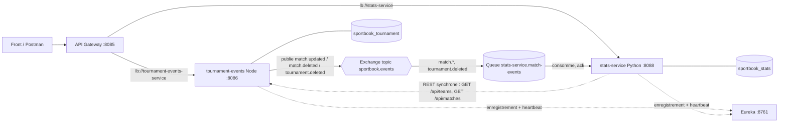

# stats-service : classement Elo, statistiques et pronostics (Python / FastAPI)

| | |
|---|---|
| Langage | Python 3.10+ · FastAPI |
| Port | **8088** |
| Nom Eureka | `stats-service` (Gateway : `lb://stats-service`, chemin `/api/stats/**`) |
| Base propre | MySQL `sportbook_stats` (créée automatiquement) |
| Swagger | http://localhost:8088/api-docs |

## Pourquoi un microservice séparé, en Python ?

- **Responsabilité unique :** le service des tournois *enregistre* les matchs, celui-ci *analyse* les résultats.
- **Le bon langage pour le bon besoin :** Python est le langage de référence pour le calcul et les données.
- **Base propre :** il ne lit jamais `sportbook_tournament`. Il garde sa propre copie des matchs terminés (un *read model*).
- **Indépendance :** si stats-service tombe, on peut toujours créer des tournois et saisir des scores.

## Architecture



| Interaction | Type | Pourquoi |
|---|---|---|
| Score saisi → classement mis à jour | **Asynchrone** (RabbitMQ) | Le service Node n'attend pas les stats et ne sait même pas qu'elles existent : découplage. |
| Noms des équipes | **Synchrone** (REST via Eureka) | On a besoin de la réponse tout de suite pour l'afficher (équivalent d'OpenFeign). |
| `POST /api/stats/sync` | **Synchrone** (REST) | Rattrapage si des événements ont été perdus (RabbitMQ arrêté, service redémarré). |

## Endpoints

| Méthode | URL | Rôle |
|---|---|---|
| GET | `/api/stats/ranking?tournament_id=&order_by=elo\|points` | classement : Elo, J, V, N, D, buts, points, forme |
| GET | `/api/stats/teams/{id}?tournament_id=` | stats d'une équipe + historique Elo match par match |
| GET | `/api/stats/predict?team1=&team2=` | probabilité de victoire de chaque équipe |
| POST | `/api/stats/sync` | recopie tous les matchs terminés via REST |
| GET | `/health` | état du service, de la base et de RabbitMQ (comme Actuator) |
| GET | `/info` | version + date de dernière synchronisation |

Les erreurs ont le même format que le service Node : `{ "status": 404, "message": "..." }`
(400 au lieu du 422 par défaut de FastAPI, 503 si la base ou le service distant est indisponible).

## L'algorithme Elo (à expliquer à l'oral)

1. Chaque équipe démarre à **1500**.
2. Score attendu de A contre B : `E_A = 1 / (1 + 10^((R_B − R_A) / 400))`. Il vaut 0,5 à niveau égal.
3. Après le match : `R_A ← R_A + K × G × (S_A − E_A)`, avec `S_A` = 1 (victoire), 0,5 (nul) ou 0 (défaite), `K = 32`,
   et `G` = 1, 1,5 ou (11+n)/8 selon l'écart de buts n.
4. Ce que A gagne, B le perd.

Exemple : deux équipes à 1500, A gagne 1-0, donc A passe à 1516 et B à 1484.
Battre un favori rapporte plus que battre un outsider.

Le classement est **recalculé à chaque requête** à partir des résultats stockés.
Un score corrigé ou un match supprimé est donc pris en compte sans incohérence.

## Fiabilité des messages

- Queue et messages **durables** : ils survivent à un redémarrage de RabbitMQ.
- **ack manuel** : le message n'est supprimé qu'une fois enregistré en base. En cas d'erreur, `nack`, et il revient dans la queue.
- **Traitement idempotent** (upsert par `match_id`) : recevoir deux fois le même événement ne fausse rien.
- Au démarrage, une synchronisation REST rattrape ce qui a été manqué.

## Lancer

```bash
# Prérequis : Python 3.10+, MySQL (XAMPP) démarré
cd stats-service
python -m venv .venv
.venv\Scripts\activate          # Windows  (Linux/Mac : source .venv/bin/activate)
pip install -r requirements.txt
python run.py                   # → http://localhost:8088/api-docs
python -m pytest                # tests unitaires du calcul Elo
```

RabbitMQ (optionnel : sans lui, utiliser `POST /api/stats/sync`) :
```bash
docker run -d --name rabbitmq -p 5672:5672 -p 15672:15672 rabbitmq:3-management
# console : http://localhost:15672  (guest / guest)
```

## Scénario de démonstration

1. Lancer Eureka, la Gateway, tournament-events (8086), stats-service (8088) et RabbitMQ.
2. Dashboard Eureka : `TOURNAMENT-EVENTS-SERVICE` et `STATS-SERVICE` sont UP.
3. Dans le front (http://localhost:8086), onglet **Matchs** : saisir un score (`3-1`).
4. Log Node : `📤 Événement publié : match.updated`. Log Python : `📥 match.updated → match 12 enregistré (3-1)`.
5. Onglet **Classement** : l'Elo a changé. Console RabbitMQ : la queue `stats-service.match-events` est vide (message acquitté).
6. Arrêter stats-service, saisir d'autres scores, relancer : la synchronisation au démarrage rattrape tout.
7. Via la Gateway : `GET http://localhost:8085/api/stats/ranking`.
